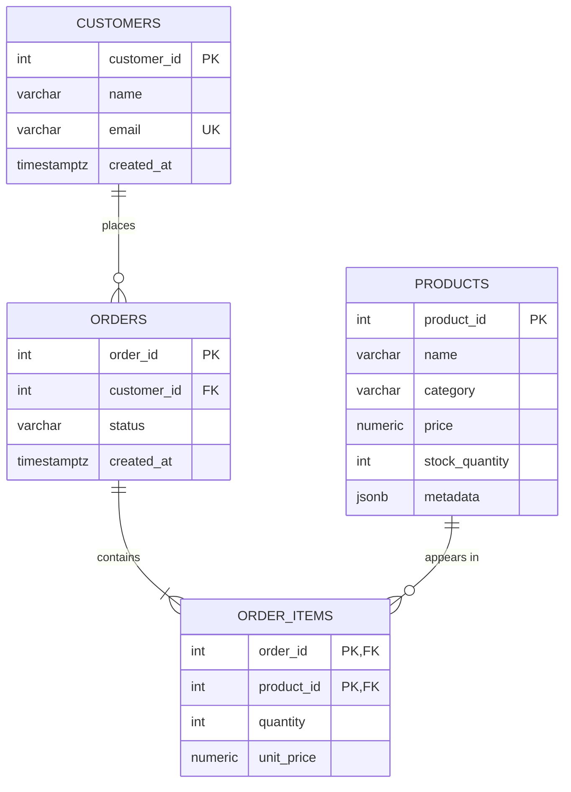

# E-Commerce Analytics Data Pipeline

Data backend for a fictional online store. Orders are processed transactionally in **PostgreSQL**, the top 10 best-selling products are cached in **Redis**, and shopping carts live in **MongoDB**.

## Quick start

```bash
docker compose up -d
python -m venv .venv
source .venv/bin/activate            # PowerShell: .venv\Scripts\Activate.ps1
pip install -r requirements.txt

python setup_db.py                   # creates tables, loads sample data, adds the cart TTL index
python -m pytest -v                  # 18 tests; also resets all three databases
```

Example usage from a Python shell in the project root:

```python
>>> from app.store import create_order, get_customer_orders, get_top_products, add_to_cart, checkout
>>> create_order(4, [(3, 2), (5, 1)])
>>> get_customer_orders(4)
>>> get_top_products()
>>> add_to_cart("sess-1", 3, quantity=2)
>>> checkout("sess-1", 4)
```

Uses **psycopg 3** (the successor to psycopg2) with `psycopg-pool` for connection pooling.

## Entity-Relationship Diagram



## Schema explanation

| Table | Purpose |
|---|---|
| `customers` | Registered shoppers. |
| `products` | Catalog with price, stock and flexible metadata (sizes, colors). |
| `orders` | One purchase by a customer, with its status. |
| `order_items` | Junction table between orders and products: what was bought, how many, at what price. |

### Normalization (3NF)

- **1NF:** every column is atomic; an order's products are rows in `order_items`, not a list in `orders`.
- **2NF:** `order_items` has a composite key `(order_id, product_id)`, and both `quantity` and `unit_price` depend on the **whole** key (this product in this order). Product details like `name` depend only on `product_id`, so they live in `products`.
- **3NF:** no non-key column depends on another non-key column.

**Key decisions:**

- **`unit_price` is not a duplicate of `products.price`.** It records the price at the moment of purchase; product prices can change later.
- **No `total` column on `orders`.** The total is derived from `order_items` (`SUM(quantity * unit_price)`), so storing it would risk inconsistency.
- **`category` is a plain column.** It's a fact about the product with no attributes of its own, so it doesn't violate 3NF. It would become its own table only if categories gained attributes.
- **`metadata` (JSONB)** holds attributes that vary by product type: numeric shoe sizes, letter shirt sizes, charger wattage.

### Constraints

- `CHECK (stock_quantity >= 0)`: the database itself refuses to oversell.
- `CHECK` on prices, quantities and allowed order statuses.
- `ON DELETE CASCADE` on `order_items.order_id`: items are part of their order. Products use the default, so a product with sales history can't be deleted.

## Design decisions

### Transactional orders (`create_order`)

The order, its items and every stock change happen in **one transaction**. If any item fails, everything rolls back, including stock already reserved for earlier items.

Stock is reserved with a single conditional statement:

```sql
UPDATE products SET stock_quantity = stock_quantity - %s
WHERE product_id = %s AND stock_quantity >= %s
RETURNING price
```

Checking stock with a SELECT and then updating would allow a **race condition**: two simultaneous orders could both see the last item in stock. One UPDATE with the condition in its WHERE clause checks and reserves atomically, and `RETURNING price` captures the purchase price in the same step.

### Top 10 products (Redis, cache-aside)

`get_top_products` ranks products by units sold with `RANK()` (excluding cancelled orders), then caches the result in Redis for 10 minutes. Reads hit Redis first; on a miss, or if Redis is down, PostgreSQL is queried and the cache refilled. The list may be up to 10 minutes stale, which is acceptable for a best-sellers list.

### Carts (MongoDB)

A cart is a self-contained, frequently changing document that doesn't need foreign keys or multi-table transactions, so it lives in MongoDB, one document per browsing session. `checkout` turns the cart into an order in PostgreSQL and deletes the cart only after the order succeeds; a failed checkout keeps the cart. A **TTL index** on `updated_at` deletes carts 7 days after their last change.


## Performance report

**Dataset** (`sql/queries.sql`): 50,000 customers, 500,000 orders, 500,000 order items, 100,000 products.

| Query | Index | Before | After | Speedup |
|---|---|---|---|---|
| A customer's orders (`get_customer_orders`) | B-tree on `orders(customer_id)` | 44.5 ms | 0.24 ms | ≈ 185× |
| Products with gold color (`find_products_by_metadata`) | GIN on `products(metadata)` | 74.5 ms | 2.26 ms | ≈ 33× |

**B-tree on `customer_id`:** without it, PostgreSQL scanned all 500,000 orders to find one customer's 10. With it, a Bitmap Index Scan goes straight to them. It also covers a PostgreSQL detail: foreign key columns are not indexed automatically.

**GIN on `metadata`:** a B-tree can't search inside JSON. GIN indexes every key and value within each document, so the `@>` containment query jumps to the matching products instead of opening all 100,000 JSON values.

**Trade-off:** indexes make writes slightly slower, since each insert also updates the index. Both queries are frequent reads, so the cost is worthwhile. Indexes help most when a query selects a small fraction of rows, which is why the benchmark searches for a rare color.

Both indexes are included at the end of `schema.sql`; `queries.sql` drops them before the "before" measurement so the benchmark is reproducible.